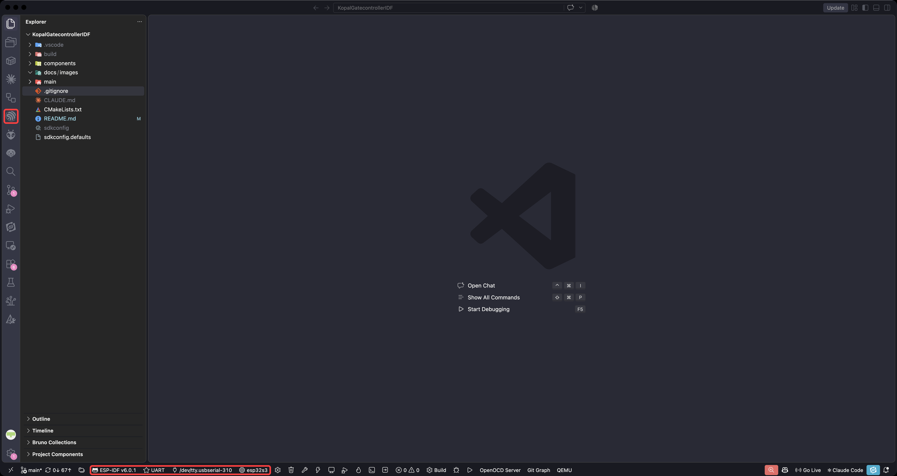
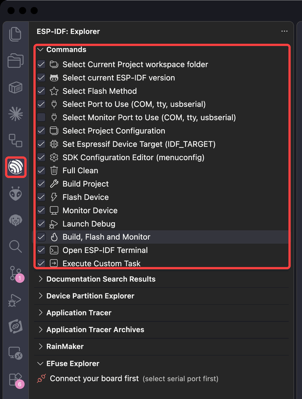
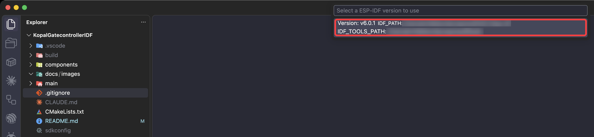
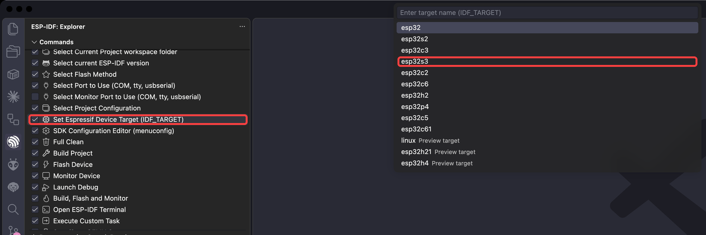
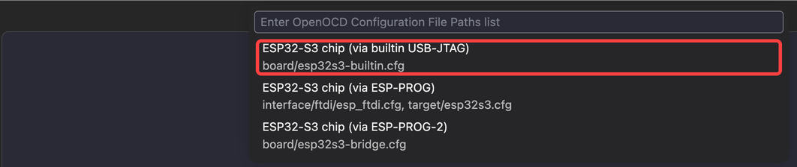
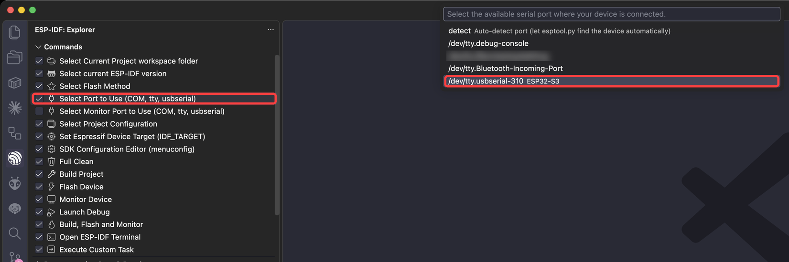
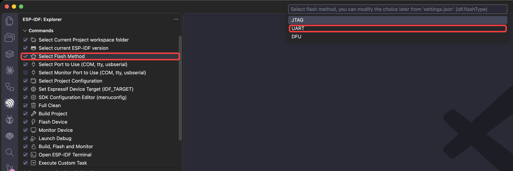
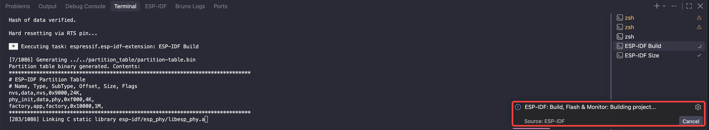
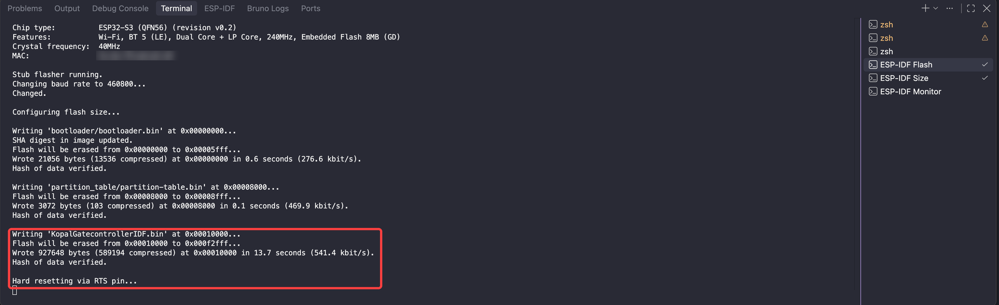
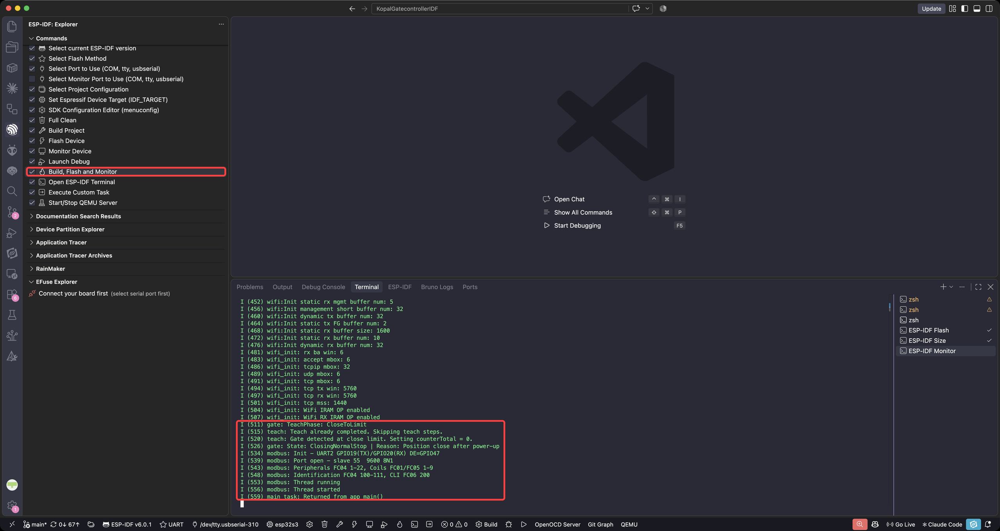

# KopalGatecontrollerIDF

Firmware for the Kopal gate controller board (ESP32-S3)

- [1. What you need](#1-what-you-need)
- [2. Install VS Code and ESP-IDF (once)](#2-install-vs-code-and-esp-idf-once)
- [3. Open the project](#3-open-the-project)
- [4. Set up the project (once)](#4-set-up-the-project-once)
- [5. Build, flash and monitor](#5-build-flash-and-monitor)
- [6. Changing settings](#6-changing-settings)
- [7. Problems](#7-problems)
- [8. Command line (optional)](#8-command-line-optional)
- [9. Where the code is](#9-where-the-code-is)

---

## 1. What you need

| | |
|---|---|
| Board | Kopal gate controller with ESP32-S3 |
| Cable | USB-serial cable to the board's console connector|
| Computer | Windows, macOS or Linux |
| Software | VS Code + the ESP-IDF extension + **ESP-IDF v6.0.1** (installed in step 2) |

---

## 2. Install VS Code and ESP-IDF (once)

1. Install **VS Code**
2. In VS Code, open **Extensions** (`Ctrl+Shift+X`, Mac `⌘⇧X`), search **ESP-IDF** and install
   the extension by **Espressif Systems**.
3. Press `Ctrl+Shift+P` (Mac `⌘⇧P`), type **ESP-IDF: Open ESP-IDF Installation Manager** and press Enter.
4. In the installation manager choose **ESP-IDF v6.0.1** and install it with the default options.
   This downloads the compiler and tools (about 2–3 GB, takes a while).
5. **Windows only:** if the board later does not show up as a `COM` port, install the driver of
   the USB-serial chip in the cable (usually CP210x or CH340).

---

## 3. Open the project

1. **File → Open Folder…** and choose the `KopalGatecontrollerIDF` folder.
2. The blue bar at the bottom shows the ESP-IDF settings of this project:
   **ESP-IDF version**, **flash method**, **port** and **target**.
3. The **Espressif icon** in the left bar opens the **ESP-IDF: Explorer**.



The **ESP-IDF: Explorer** has a **Commands** list with everything you need.
All next steps use this list.



---

## 4. Set up the project (once)

Do these four steps the first time. VS Code remembers them for this folder.

### 4.1 Select the ESP-IDF version

Click **Select current ESP-IDF version** and choose **v6.0.1**.



### 4.2 Set the target: esp32s3

1. Click **Set Espressif Device Target (IDF_TARGET)**.
2. Choose **esp32s3**.



3. A second list asks for the OpenOCD (debugger) configuration. Choose the first one,
   **ESP32-S3 chip (via builtin USB-JTAG)**. It is only used for JTAG debugging, not for flashing.



4. Wait until **"Target ESP32S3 Set Successfully"** appears at the bottom right.

> Setting the target does a **full clean**: the `build` folder and `sdkconfig` are
> deleted and made again from `sdkconfig.defaults`.

### 4.3 Select the port

1. Plug in the board's console cable.
2. Click **Select Port to Use (COM, tty, usbserial)**.
3. Choose the board: `/dev/tty.usbserial-…` on a Mac, `COM3`, `COM5`, … on Windows.
   VS Code shows **ESP32-S3** next to the right one.



> Not in the list? Check the cable, close the list (`Esc`) and open it again.
> Windows: see step 2.5 (driver).

### 4.4 Select the flash method: UART

Click **Select Flash Method** and choose **UART**.



---

## 5. Build, flash and monitor

Click **Build, Flash and Monitor**. This does three things in a row:

**1. Build.** The first build takes **2–5 minutes**; later builds only compile what changed.
The progress shows in the terminal at the bottom.



**2. Flash.** The firmware is written to the board. It is done when you see
**"Hash of data verified"** and **"Hard resetting via RTS pin"**.



**3. Monitor.** The board restarts and its log appears. Lines starting with `gate:`,
`teach:` and `modbus:` come from this firmware.



Close the monitor with **`Ctrl+]`**.

**Separate steps:** the same list also has **Build Project**, **Flash Device** and
**Monitor Device**, to do one step at a time.

---

## 6. Changing settings

Use **SDK Configuration Editor (menuconfig)** in the Commands list, change the setting and
click **Save**. Example: the log level is under *Component config → Log → Default log verbosity*
(*Info* is normal, *Debug* shows much more).

Good to know:

- Your settings are saved in `sdkconfig`. That file is **not** in git (`.gitignore`), so every
  computer makes its own.
- The project's fixed settings are in **`sdkconfig.defaults`** (in git). That file is only read
  when `sdkconfig` is created. After changing it, run **Full Clean** (or set the target again)
  so `sdkconfig` is made again.
- Do not change these defaults: the 1 ms FreeRTOS tick (motor timing) and the console on UART0
  (GPIO 19/20 are used for the RS485 Modbus port, not for USB).

---

## 7. Problems

| Problem | What to do |
|---|---|
| The port is not in the list | Check the cable (it must be the console cable, not the RS485 adapter). Windows: install the CP210x / CH340 driver. |
| Flashing stops with *"port is busy"* or *"could not open port"* | Close the monitor (`Ctrl+]`) or any other program that uses the port, and try again. |
| Flashing stops halfway or *"timed out"* | Use a shorter or better USB cable. Try again. |
| *"Wait for ESP-IDF set target to finish"* | The target step is still running. Wait for "Target ESP32S3 Set Successfully". |
| Build errors after changing `sdkconfig.defaults` | Run **Full Clean**, then build again. |
| The monitor shows nothing | Press the reset button on the board, or close and reopen **Monitor Device**. |

---

## 8. Command line (optional)

The same steps without VS Code, in a terminal where ESP-IDF is activated
(on Windows: the *ESP-IDF 6.0 PowerShell* shortcut made by the installer):

```bash
idf.py set-target esp32s3       # once
idf.py build
idf.py -p PORT flash monitor    # PORT = COM5, /dev/tty.usbserial-310, ...
```

**One file for someone else to flash.** `idf.py merge-bin` makes `build/merged-binary.bin`
(bootloader, partition table and app in one file). Flash it with
[esptool](https://docs.espressif.com/projects/esptool/) (`pip install esptool`):

```bash
esptool --chip esp32s3 -p COM5 -b 460800 write-flash 0x0 merged-binary.bin
```

`-p` and `-b` can be left out: esptool then finds the port itself and uses 115200 baud
(slower, about 1.5 minutes).

---

## 9. Where the code is

Every part of the firmware is a component in `components/`:

| Component | Responsible for |
|---|---|
| `main` | Startup: create the modules, connect them, start their tasks |
| `board` | Pin numbers |
| `config` | Settings, factory defaults per gate model, storage in flash (NVS) |
| `hal_io` | Digital inputs and outputs |
| `hal_motor` | Motor driver (speed/torque PWM, run and direction pins) |
| `hal_counter` | Encoder pulse counter |
| `motor_control` | Speed ramps, safety trips and backtrack |
| `app_controller` | The gate itself: state machine, commands, lock/beacon/light, teach |
| `modbus` | Modbus RTU slave on RS485 (slave 55, 9600 8N1) |
| `wifi` | Wi-Fi access point |
| `web` | Configuration web pages |
